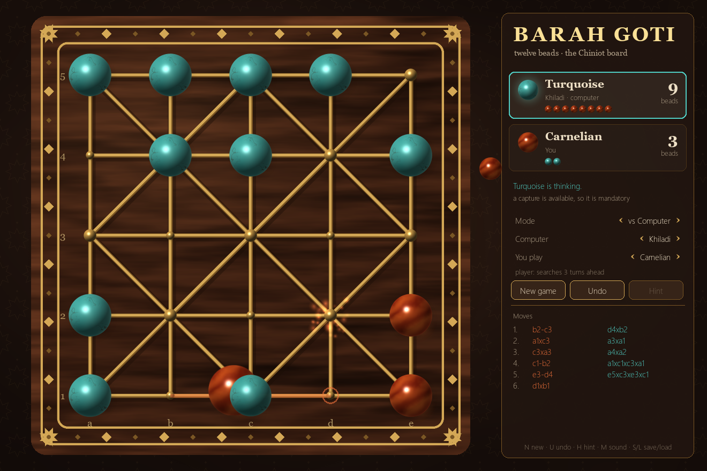

# BarahAI · Barah Goti (12 Beads)

Barah Goti (بارہ گوٹی, "twelve beads"), also called Bara Tehni, 12 Guti or Baro Guti, is the
village board game of Punjab, Sindh, Bihar and Bengal, rebuilt in Python. It has a
rules engine, three computer opponents and a pygame desktop client drawn entirely
in code: no image or audio files.



This folder replaces the old C++/SFML version in [`SilverUmer21/twelve_beads`](https://github.com/SilverUmer21/twelve_beads)
(see [what was wrong with it](#autopsy-of-the-legacy-c-version)).

```
barahai/
├── src/barahai/
│   ├── engine/     rules engine: pure Python, zero dependencies
│   ├── agents/     Random, Greedy (rule-based), Alpha-beta search
│   └── game/       pygame-ce client: art, sound, app, search worker
├── tests/          39 tests incl. differential tests against a naive engine
└── scripts/arena.py   bot-vs-bot tournaments and an engine speed check
```

## Quick start

```bash
python -m venv .venv
```
```bash
.venv\Scripts\python -m pip install -e .[game,dev]
```
```bash
.venv\Scripts\python -m barahai.game
```

Run the tests with `.venv\Scripts\python -m pytest`, and bot tournaments with
`.venv\Scripts\python scripts\arena.py random greedy alphabeta-d2 alphabeta-d4`.

---

## The rules

### Board

A square of 5 × 5 points: 16 small boxes, the two long diagonals, and a diamond
joining the midpoints of the sides (the Alquerque board). Diagonal lines only pass
through the **strong points**, where `row + col` is even. These have up to 8
neighbours. The other points (**weak points**) connect only orthogonally.

```
  5  o───·───o───·───o        o strong point (diagonals)
     │ ╲ │ ╱ │ ╲ │ ╱ │        · weak point (orthogonal only)
  4  ·───o───·───o───·
     │ ╱ │ ╲ │ ╱ │ ╲ │        24 beads, centre empty:
  3  o───·───o───·───o          Turquoise: ranks 4-5 + a3, b3
     │ ╲ │ ╱ │ ╲ │ ╱ │          Carnelian: ranks 1-2 + d3, e3
  2  ·───o───·───o───·
     │ ╱ │ ╲ │ ╱ │ ╲ │
  1  o───·───o───·───o
     a   b   c   d   e
```

### Play (the BarahAI standard ruleset)

1. **Setup.** Each player has 12 beads filling the two rows nearest them plus the
   two middle-row points on their right. Only the centre is empty.
2. **Turns.** Carnelian moves first, then turns alternate. On your turn you either
   *step* or *capture*.
3. **Step.** Move one bead along a line to an adjacent empty point, in any
   direction. There is no "forward only" rule and no promotion.
4. **Capture.** Jump over an adjacent enemy bead, along a straight line, onto the
   empty point directly beyond it. The jumped bead is removed.
5. **Chain capture.** If the jumping bead can capture again from where it lands, it
   keeps jumping in the same turn. It may change direction between jumps.
6. **Captures are mandatory.** If any capture is available you must capture, and a
   chain must be continued while it can be. When several captures are available
   you may choose any of them (the longest is not required).
7. **Winning.** You win by capturing every enemy bead, or when your opponent has no
   legal move on their turn (blocked).
8. **Draws.** The game is drawn after **40 consecutive turns without a capture**,
   when the **same position with the same side to move occurs 3 times**, or at a
   300-turn safety cap.

### Why these choices

The historical records agree on the board, the setup, single-step moves, jump
captures and the win by capturing everything. They are silent on the rest, and
modern sources disagree:

| Question | What the sources say | BarahAI default |
|---|---|---|
| Multi-jump in one turn? | Not mentioned in the 1919/1923 Punjab record; allowed by AlignIt, twelvebead.com and 12beadsgame.com | **Yes**, direction may change |
| Capture compulsory? | Mandatory in the Bead 12 app and 12beadsgame.com; optional in many house rules (AlignIt) | **Mandatory** |
| Blocked player? | AlignIt and 12beadsgame.com: a win for the opponent | **Loses** |
| Draws? | 12beadsgame.com: 1 bead each + 8 quiet moves; others: by agreement | **40 quiet turns / threefold repetition** |

Every choice is a flag in `barahai.engine.Rules`, so other variants need no code
changes:

```python
Rules(forced_capture=True, chain_capture=True, quiet_limit=40,
      repetition_limit=3, max_turns=300, first_player=0)
```

With `forced_capture=False`, captures and chain continuations become optional, and
a `STOP` action ends a chain early.

### Notation

Files `a`-`e` run left to right and ranks `1`-`5` bottom to top, from Carnelian's
side. A step is `c2-c3` and a capture chain is `a1xc3xc1xa1`.

---

## Playing the game

| Input | Action |
|---|---|
| Click a bead, then a glowing point | Move (or drag the bead there) |
| Red ring on a point / around a bead | Capture landing spot / the bead you would take |
| Pulsing brass ring | A capture is available, so one of these beads must jump |
| `N` / `U` or `Ctrl+Z` / `H` | New game / take back your last turn / hint |
| `M` / `S` / `L` / `Esc` | Sound on-off / save / load (`~/.barahai/saved_game.json`) / deselect |

**Modes:** vs Computer (pick your colour), Two players (hotseat), Watch computers.

**Computer levels**

| Level | Engine | Notes |
|---|---|---|
| Naya (beginner) | Greedy, 30 % random moves | Grabs beads, avoids hanging its own, makes mistakes |
| Khiladi (player) | Alpha-beta, 3 turns | Deterministic for a given seed |
| Ustad (master) | Alpha-beta, iterative deepening, 1 s | As deep as the clock allows |

### The Chiniot board

The look is based on Chiniot (Punjab) sheesham-wood furniture with brass inlay:

- **Board.** Lacquered sheesham wood made from fractal noise, brass inlay lines in
  a routed groove, a band of brass diamonds with *khatim* (eight-pointed star)
  corner medallions, and a brass jali lattice behind it.
- **Beads.** Carnelian (*aqeeq*) and Persian turquoise (*feroza*). Each is shaded
  per pixel as a real dome: diffuse, specular and Fresnel lighting. Carnelian also
  transmits light, glowing from inside and casting orange light on the wood.
  Turquoise has a procedural spiderweb matrix.
- **Motion.** Steps ease out; jumps arc, lifting the bead and stretching its
  shadow. A captured bead bursts into sparks and flies to its captor's tray. The
  last turn stays traced on the board, and the winner's beads pulse in a wave.
- **Sound.** Synthesised with numpy: wood taps, stone clacks, and plucked-string
  phrases in Raag Yaman (Karplus-Strong) for a win, loss or draw.

Everything is baked once per window size and cached, so a frame is mostly blits:
about 3.3 ms against the 16.7 ms budget for 60 fps. Searches run in a separate
**process**. On a thread they froze the window for up to 1 s, because every
pygame blit gives up the GIL and then waits behind the busy search to get it back.
With the worker process the window holds 60 fps (worst frame 20 ms) while Ustad
thinks.

---

## Engine design

- **Bitboards.** A position is two 25-bit Python ints. Move generation shifts whole
  bitboards per direction against precomputed masks: about 116k actions/s in pure
  Python, single-threaded.
- **Atomic actions.** A turn is one or more actions. Each action is one step or one
  jump, encoded as `direction × 25 + from_square` (0-199), plus `STOP` = 200. Step
  and jump never share an id, because the neighbour in that direction is either
  empty or an enemy. Mid-chain, the same player simply acts again with only the
  jumping bead allowed to move. The action space is fixed at 201 ids.
- **Immutable states.** `GameState.apply(action)` returns a new state. Undo is
  popping a list, search needs no unmake logic, and states can be sent to the
  search process as they are.
- **Rules are enforced in the state.** `legal_actions()`, `action_mask()`,
  `is_legal()` and `describe()` (src, dst, captured) are the only ways to move.
  Illegal input raises `IllegalMoveError` and is never silently ignored.
- **Game records.** `GameRecord` stores the rules plus the action list as JSON and
  replays it exactly (it also validates every move on load).

### How it is verified

- **Differential testing.** [`tests/reference.py`](tests/reference.py) is a
  deliberately naive 2D-grid move generator that shares no code with the engine.
  The two must agree on every legal move in over 5,000 positions from random games,
  under each of the 4 capture-rule variants.
- **Symmetry.** The rules ignore orientation, and the strong-point pattern survives
  all 8 rotations and reflections of the square. A test checks that transforming a
  position transforms its legal moves the same way.
- **Perft.** Leaf counts from the start position at depths 1-6 are pinned:
  `4, 5, 6, 12, 19, 64`. The opening is narrow because the first move must enter
  the centre, and the reply is then a forced capture.
- **Rule scenarios.** Corner-turning chains, optional `STOP`, weak points having no
  diagonals, blocked-loses, threefold repetition, quiet-turn draws, bead
  conservation, and save/load round trips.
- **Strength ladder.** 20 games per pairing, colours alternated
  (`scripts/arena.py`):

| Pairing | Score | Draws | Avg turns |
|---|:-:|--:|--:|
| random vs greedy | 0 – 20 | 0 | 35 |
| random vs alphabeta-d2 | 0 – 20 | 0 | 28 |
| random vs alphabeta-d4 | 0 – 20 | 0 | 27 |
| greedy vs alphabeta-d2 | 1 – 9 | 10 | 64 |
| greedy vs alphabeta-d4 | 0 – 11 | 9 | 60 |
| alphabeta-d2 vs alphabeta-d4 | 0 – 14 | 6 | 54 |

The ladder is ordered: each stronger bot clearly beats the one below it. Draws
show up mostly between closer opponents, where neither side can force captures.

---

## Autopsy of the legacy C++ version

Line numbers refer to [`twelve_beads.cpp`](https://github.com/SilverUmer21/twelve_beads/blob/main/twelve_beads.cpp).

| # | Bug | Where | Effect |
|---|---|---|---|
| 1 | The turn switches whether or not a move happened | 595, 825 | Clicking a wrong point forfeits your turn and the bot moves |
| 2 | Clicking another of your own beads counts as a move attempt | 558 | You cannot change your selection without losing the turn |
| 3 | Out-of-bounds reads and writes: `board[r-2]`, `board[r][c+2]` with no bounds checks | 107-245 | Undefined behaviour. `board[r][5]` is really `board[r+1][0]`, so beads can wrap around the edge to the next row |
| 4 | The clicked destination is ignored | 561-593 | Clicking two points away steps one; clicking next to an enemy jumps |
| 5 | No chain captures, no forced capture, no blocked or draw rules | — | A blocked position hangs the game forever |
| 6 | The bot only scans interior points (`1..3`) and misses all edge moves | 249-251 | It passes silently when only edge moves exist |
| 7 | The bot's bounds guards check the wrong index (`i>=2` where `j-2` is used) | 296 | Illegal captures across rows |
| 8 | A failed parity check inside the bot's `else if` chain skips all later options | 259-432 | Valid moves are never tried |
| 9 | The win screen calls `Sleep(30000)` on the UI thread, and its "float" animation is computed once | 465-478 | The window freezes with "Not responding" for 30 s |
| 10 | Buttons poll `isButtonPressed` every frame | 649, 869, 999 | One click saves dozens of times; clicks fall through to the next screen |
| 11 | Hover plays the click sound every frame | 665, 958 | Sound spam |
| 12 | The background texture is reloaded from disk every frame | 1173 | Constant disk IO in the menu |
| 13 | Game flags are never reset after a game | 1190-1201 | Closing a game relaunches it forever; there is no way back to the menu |
| 14 | The board is a global that is never reset | 25 | A new game starts from the finished position |
| 15 | A 500 × 500 window holding a 25 px offset plus five 100 px cells | 489, 620 | The last column draws off-screen |
| 16 | Two copy-pasted 200-line game loops; Windows-only `Sleep`, `windows.h` | 484-927 | Fixes have to be made twice; it does not build elsewhere |
| 17 | `std::thread` started only to call `music.play()` (SFML already streams on its own thread) | 1192 | Pointless thread |

---

## Sources

- H. C. Das-Gupta (1923), "Notes on a Type of Sedentary Game Prevalent in Many Parts of India", *J. Proc. Asiatic Society of Bengal* 19: 71-74. Punjab and Simla, 1919, via [Ludii: Bára Guti](https://ludii.games/data.php?gameId=612)
- C. Das Gupta (1935), "A Few Types of Sedentary Games from Bihar", *J. Asiatic Society of Bengal* 1: 409-418. The circular Bihar variant, via [Ludii: Bara Guti (Bihar)](https://www.ludii.games/data.php?gameId=778)
- [gamerules.com: 12 Beads](https://gamerules.com/rules/12-beads/)
- [AlignIt Games: Bara Tehni rules](https://alignitgames.com/games/bara-tehni.html)
- [12beadsgame.com](https://12beadsgame.com/)
